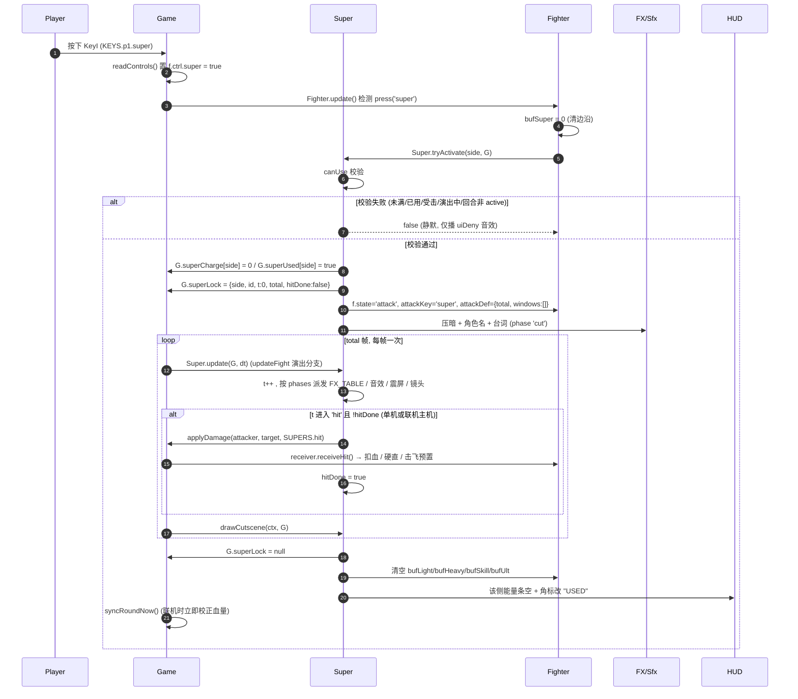
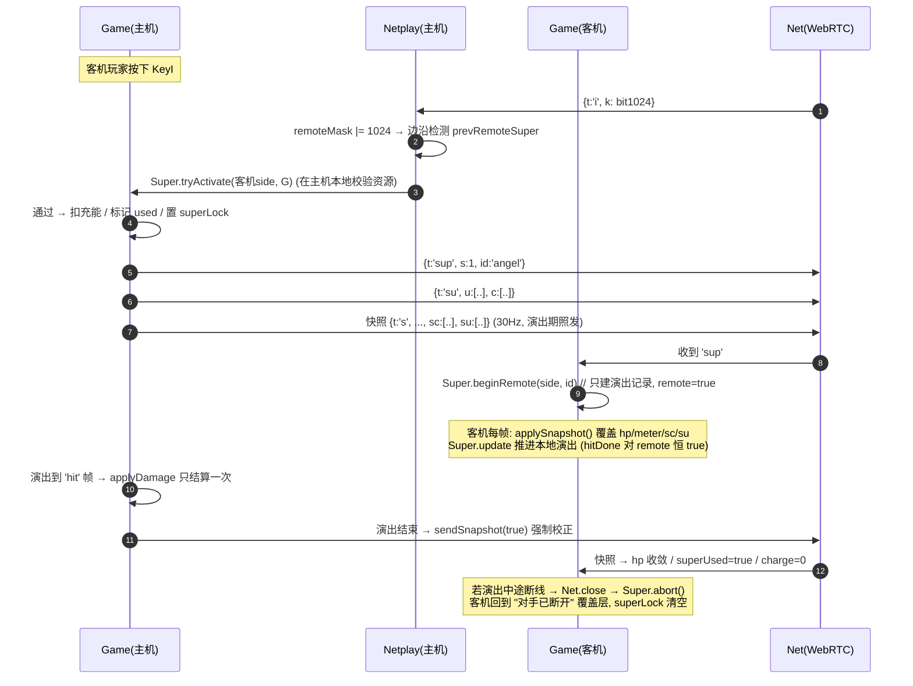
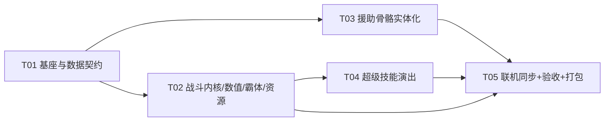

# 第三期增量功能 · 系统设计（carry格斗 / 陈锴瑞 VS 陈锴瑞 · 八相乱斗）

> 设计人：架构师 高见远 ｜ 版本：v3-draft-1
> 范围：①天使必杀俯冲段 Lv3 霸体 ②7 个援助骨骼实体化 ③血量翻倍 + 每角色超级技能（全屏奥义）
> 约束：纯原生 Canvas2D / `window.BVN` + IIFE + `'use strict'` / 无框架无构建无 CDN / `file://` 双击可跑 / 传统 `<script>` 顺序加载。

---

## 0. 代码库事实核对（已打开文件逐条确认，含行号）

| # | 事实 | 位置 | 对本设计的影响 |
|---|---|---|---|
| F1 | 脚本顺序硬依赖（14 个文件） | `index.html:15-28` | 新文件必须插进正确位置；`tools/build-single.js:16-31` 的 `JS_ORDER` 必须同步 |
| F2 | `CFG.MAX_HP = 1000` | `data.js:15` | 血量翻倍的唯一数据源 |
| F3 | `Fighter.hpMax = CFG.MAX_HP` | `fighter.js:32` | 派生值，自动跟随，无需改 |
| F4 | `G.hpLag` 初值取 `CFG.MAX_HP` | `game.js:79` / `game.js:282` | 派生值，自动跟随 |
| F5 | HUD 血条按 `f.hp / f.hpMax` 比例绘制 | `game.js:1615-1616` | 比例制，无需改 |
| F6 | **唯一硬编码血量阈值**：`f.hp < 400` | `ai.js:101` | 必须改为 `f.hpMax * 0.4` |
| F7 | 其余血量判断全部比例制 | `ai.js:168`（0.32）、`fighter.js:770`（0.3） | 无需改 |
| F8 | 伤害结算唯一出口 `receiveHit()` → `rawDmg` | `fighter.js:649-753`（`669-670` 计算 `mult`、`rawDmg`） | **伤害缩放只在这里加一处乘数即可全局生效** |
| F9 | 命中反馈阈值 `clamp(dmg/40,…)`、`dmg>=80` 用绝对伤害 | `game.js:838-845` | 伤害×2 会把几乎所有命中判成"重击 hitstop"→ 手感变化，**必须除以缩放系数** |
| F10 | 治疗绝对值：天使技能 `+40`、仙人援助 `heal:200` | `skills.js:652`、`data.js:381` + `assist.js:261` | 需按 `hpMax` 比例化 |
| F11 | 霸体：`setArmor(level,frames)`、`armorBreak` 破甲、等级压制 | `fighter.js:101-105`、`fighter.js:701-723`、`data.js:127` | 天使俯冲段直接复用 Lv3（`ARMOR.BOXER`） |
| F12 | 天使必杀：升空 f=6、**俯冲 f=34**、落地爆 f=62，判定窗 `s58-e66` | `skills.js:662-727`、`data.js:137` | 霸体窗口取 `[34, 66]` |
| F13 | 角色绘制入口 `Art.drawFighter(ctx, f, time)`，`LOOKS[build]` 私有未导出 | `art.js:570-613`、`art.js:574`、`art.js:745` | 新文件无法直接注册 LOOKS → **需在 art.js 加 2 个极小的导出** |
| F14 | `drawBody` 的 LOOKS 钩子集合固定：`mood/foot/fabric/sleeve/bareLegs/ground/back/arm/legBack/hem/torso/legFront/head/armFront/front` | `art.js:615-659` | 7 个援助沿用同一套钩子即"同画风" |
| F15 | 援助当前是"菱形卡 + 立绘"，`in→act→out`，`IN=30 / OUT=20` | `assist.js:14-15`、`assist.js:382-481` | 出口位置已封装，替换绘制即可 |
| F16 | 援助 3 次 / 75 帧冷却 / 每人限选 1，跨小局保留 | `data.js:535-536`、`assist.js:50-62` | 不改，保护既有验收 |
| F17 | netcode：主机权威，客机 60Hz 输入位掩码（已用到 bit512=援助），主机 30Hz 快照 | `netplay.js:643-658`、`netplay.js:627-640` | 超级键用 bit1024 |
| F18 | 技能/援助走事件复制：`cast` / `assist` / `au` / `exec` | `netplay.js:272-294` | 超级技能照抄这套模式，新增 `sup` / `su` |
| F19 | `ATK_LIST` 决定快照里 `attackKey` 的编码 | `netplay.js:529` | 新增 `'super'` |
| F20 | `dist/index.html` 由 `tools/build-single.js` 生成（无 npm，`node` 直接跑），立绘目录扫描内联 | `tools/build-single.js:33-59` | 新 js 文件必须进 `JS_ORDER`，否则单文件版直接白屏 |

---

## 1. 实现方案与文件清单

### 1.1 核心难点与方案选型

| 难点 | 方案 | 理由 |
|---|---|---|
| 天使"只俯冲段"Lv3 霸体 | **数据驱动霸体窗口**：`SKILL_ATTACKS[id][kind].armorWindows = [{s,e,level}]`，`Fighter.updateAttack` 每帧按窗口 `setArmor(level, 2)` 续期 | 不写死 `if (id==='angel')`；与已有 `windows[]` 判定窗同构；恶龙 Lv2（`skills.js:840`）保持不变，未来新角色只加数据 |
| 援助实体化但必须"同一套画风" | 7 套 `LOOKS` 复用 `art.js` 的 `drawBody` 管线（`drawArm/drawLeg/drawTorsoBase/drawHeadBase/drawFist/drawFoot` + `shade/rgba/cloth/ribbon/taperPath`），放在新文件 `js/art-assist.js`，通过 `Art.registerLook(build, look)` 注册 | 免复制 2000 行绘制代码；`Art.drawFighter` 直接吃援助对象（只需 `x/y/facing/pose/palette/build/onGround/glow`）；art.js 只加 ~10 行导出 |
| 血量翻倍但手感不能翻倍 | **单点伤害缩放**：`CFG.DMG_SCALE = 2`，只在 `receiveHit` 的 `rawDmg` 上乘；同时修正 `onHpHit` 的绝对阈值（除回来） | 一处改动，全部相对关系（格挡 20%、pierce、连段、霸体、AI）自动守恒，零逐个数值重调 |
| 超级技能"整场一次 + 独立能量 + 全屏演出" | 资源态放 **`Game` 层**（`G.superCharge[2] / G.superUsed[2]`）而非 `Fighter`，因为 `Fighter.reset()` 每小局都会清场（`fighter.js:43-93`）；演出用 **`G.superLock` 帧驱动锁**，不走 `roundState`（避免污染 netcode 的回合状态机） | 跨小局保留天然成立；`roundState` 保持 `active` 才能让 `receiveHit` 正常结算（`fighter.js:651`） |
| 全屏演出期输入/快照 | 演出期：`readControls(locked=true)` 只清零 ctrl，但 loop 不停、快照照发；演出结束清空输入缓冲（`bufLight/bufHeavy/bufSkill/bufUlt`）+ 强制快照 | 不卡输入队列（不会积压边沿），不与主机 RTT 冲突 |
| 联机唯一资源 | 主机权威：客机只发 bit 掩码，主机做边沿检测并 `tryActivate`；主机广播 `sup`（演出）+ `su`（资源），快照附带 `sc/su` 自愈 | 与已有 `assist`/`au` 完全同构，改动面最小、最容易验证 |

### 1.2 新增文件

| 相对路径 | 职责（一句话） |
|---|---|
| `js/art-assist.js` | 7 个援助角色的程序化骨骼外观（`LOOKS`）+ 三相动作姿势关键帧；`BVN.AssistArt`，提供 `registerAll()` / `pose(build, phase, k, out)` |
| `js/super.js` | 超级技能系统 `BVN.Super`：充能、可用性校验、全屏奥义演出（压暗 + 立绘 + 终结文字 + 8 套 FX）、命中派发、HUD 数据 |
| `docs/design-v3.md` | 本设计文档 |

### 1.3 修改文件

| 相对路径 | 改什么 |
|---|---|
| `js/data.js` | ①`CFG.MAX_HP=2000`、新增 `DMG_SCALE/SUPER_MAX/SUPER_GAIN_*`；②新增 `SUPERS`（8 条，单一数据源）；③`KEYS.p1/p2` 新增 `super`；④`SKILL_ATTACKS.angel.ult` 新增 `armorWindows:[{s:34,e:66,level:3}]`；⑤`ASSISTS` 各条新增 `poseSet` 说明性字段（可选） |
| `js/art.js` | 仅新增导出：`Art.registerLook(id, look)`、`Art.kit = { shade, rgba, ell, circle, taperPath, cloth, ribbon, at, pt, roundRect }`（+ 供 `art-assist.js` 用的 `Art.HOOK_SIG` 注释）。**不改任何已有绘制逻辑** |
| `js/assist.js` | 援助记录改为"场上骨骼实体"：`pose/state/animTime/facing/x/y` 落地、`in/act(windup-strike-recover)/out` 三相驱动姿势；`draw` 由菱形卡改为 `Art.drawShadow + Art.drawFighter + 地面法阵 + 头顶名牌`；`actLen` 增加 7 条显式帧数 |
| `js/fighter.js` | ①`receiveHit` 施加 `CFG.DMG_SCALE`；②`updateAttack` 支持 `def.armorWindows`；③新增 `superReadyOf()` 只读查询；④`reset()` 不触碰 super 资源（资源在 Game） |
| `js/skills.js` | 治疗量比例化（天使 `+40` → `hpMax*0.04`）；`Skills.use` 支持 `kind='super'`（复用 `attackDef` 驱动，供演出期本地动作） |
| `js/game.js` | ①`onHpHit` 绝对阈值除回缩放；②`G.superCharge/G.superUsed` 生命周期（`startFight`/`startNetFight` 重置、`resetRound` **不重置**）；③`readControls` 读取 P1/P2 超必杀键；④`drawHpBlock` 增加第二能量条；⑤`updateFight` 演出分支（锁输入 + 暂停计时 + 仍发快照）；⑥`G.draw` 挂载 `BVN.Super.drawCutscene`；⑦`onHpHit/onBlock` 里给超必杀充能 |
| `js/ai.js` | `f.hp < 400` → `f.hp < f.hpMax * 0.4`；新增超必杀决策（`Super.canUse` 时按难度概率释放） |
| `js/netplay.js` | `ATK_LIST` 增 `'super'`；输入掩码 bit1024；`packFighter` 增 `sc/su`；`onData` 增 `sup`/`su`；主机边沿触发；`leave/close` 时 `Super.abort()` |
| `tools/build-single.js` | `JS_ORDER` 插入 `js/art-assist.js`（在 `js/art-bg.js` 之后）、`js/super.js`（在 `js/skills.js` 之后、`js/assist.js` 之前） |
| `index.html` | 同步插入两个 `<script>` |
| `README.md` / `部署指南.md` | 键位表加超必杀键、数值改为 HP 2000、增"超级技能"与"援助实体化"两节、补 `dist` 重建说明 |

### 1.4 加载顺序（与 `index.html`、`JS_ORDER` 三处必须一致）

```
vendor/peerjs.min.js
data.js            ← SUPERS / MAX_HP / KEYS.super 最先就位
net-config.js
audio.js
effects.js
art.js             ← 导出 registerLook / kit
art-bg.js
art-assist.js      ★ 新增：注册 7 套 LOOKS（依赖 art.js 的 kit）
skills.js
super.js           ★ 新增：只依赖 data.js / art.js / FX
assist.js          ← 使用 art-assist 已注册的 LOOKS
fighter.js
ai.js
net.js
netplay.js
game.js
```

> 顺序理由：`art-assist.js` 只依赖 `art.js`（注册期不绘图），放 `art-bg.js` 后不会与背景模块产生时序耦合；`super.js` 需要 `data.js` 的 `SUPERS` 与 `art.js` 的 `drawCover/img`，且被 `assist.js/fighter.js/game.js` 反向调用（运行时），放在 `skills.js` 之后可保证 `BVN.FX`、`BVN.Skills` 已存在。

---

## 2. 数据结构与接口（字段级）

### 2.1 `CFG` 新增/修改（`js/data.js`）

```js
const CFG = {
  MAX_HP: 2000,            // ← 1000 → 2000
  DMG_SCALE: 2,            // 伤害/治疗统一缩放系数（唯一出口 receiveHit）
  MAX_METER: 100,          // 不变（普通气条）
  ROUND_TIME: 99,          // 不变（伤害同步缩放后 TTK 不变，无需延长/缩短）
  // ★ 超级技能（与气条完全独立的第二条资源）
  SUPER_MAX: 100,          // 充能上限
  SUPER_GAIN_DEALT: 0.10,  // 造成伤害 → 充能 = dmg / 10（2000 血打满一条血 ≈ 充能满）
  SUPER_GAIN_TAKEN: 0.04,  // 受到伤害 → dmg / 25
  SUPER_GAIN_REGEN: 1.6,   // 每秒自然充能（打不到人也不会完全卡死）
  SUPER_GAIN_PERFECT: 8,   // 完美格挡额外充能
};
```

### 2.2 `KEYS` 新增

```js
KEYS.p1.super = ['KeyI'];                    // I
KEYS.p2.super = ['Digit6', 'Numpad6'];       // 6（主键盘/小键盘）
```
（现键位：P1 `A D W S / J K L U / E / Shift`，`I` 空闲；P2 `← → ↑ ↓ / 1234 / 5 / 0`，`6` 空闲。）

### 2.3 `SUPERS`（新增，8 条，单一数据源）—— 字段契约

```js
BVN.SUPERS = {
  angel: {
    id: 'angel',                  // string，必须 === ROSTER[].id
    name: '炽翼·天罚之光',          // string ≤ 8 字：HUD / 演出字幕 / 结算显示
    kanji: '天罚',                 // string 2~4 字：全屏终结文字（超大字）
    romaji: 'ANGELUS',            // string：终结文字下方副标（可空串）
    quote: '光明，从不宽恕。',       // string ≤ 12 字：演出台词
    cost: 100,                    // number 0~SUPER_MAX：解锁充能
    total: 150,                   // number：演出总帧数（60fps，2.0~2.8 秒）
    phases: [                     // Array<{n:string, s:number, e:number}> 左闭右开
      { n: 'cut',  s: 0,   e: 34  },   // 压暗 + 立绘滑入 + 角色名/台词
      { n: 'text', s: 20,  e: 62  },   // 终结文字砸入
      { n: 'anim', s: 34,  e: 118 },   // 技能动画（本地动作 + 全屏特效）
      { n: 'hit',  s: 118, e: 124 },   // 判定帧（主机在此结算）
      { n: 'out',  s: 124, e: 150 },   // 定帧 + 淡出
    ],
    hit: {                        // 命中描述（结构与 receiveHit 的 hit 参数一致）
      dmg: 500,                   // 未缩放的"账面值"；实际生效 = dmg * CFG.DMG_SCALE
      hitstun: 50, kb: 560, lift: 520, pierce: 0,
      unblockable: true,          // 奥义必中，不吃格挡
      armorBreak: 3,              // 打穿一切霸体（含拳击 Lv3）
      sfx: 'ko',
    },
    cam: { zoom: 1.55, shake: { frame: 118, mag: 26, dur: 26 } },
    tint: '#ffd76e',              // 演出主色（压暗层染色 / 文字 / 描边）
    fx: 'holyRain',               // string：super.js 的 FX_TABLE 键（8 个互不相同的实现）
    portrait: { side: 1, fx: 0.57, fy: 0.18, zoom: 2.2 }, // 立绘位置：side -1 左 / +1 右
  },
  /* hannya / boxer / dancer / dragon / warlock / ranger / ronin 同构 */
};
```

> 8 条的差异化见 §6 表格。`fx` 指向 `js/super.js` 内的 `FX_TABLE[fx](ctx, ctx2)`，避免把 8 个角色写成 8 个巨型函数体，也让"演出互不相同"有独立实现点。

### 2.4 `SKILL_ATTACKS[id][kind].armorWindows`（新增可选字段，本期只有天使使用）

```js
// data.js → SKILL_ATTACKS.angel
ult: {
  total: 110,
  windows: [{ s: 58, e: 66, dmg: 150, /* 不变 */ }],
  armorWindows: [{ s: 34, e: 66, level: 3 }],   // ★ 只覆盖"俯冲 → 落地撞击"这一段
},
```
语义（`fighter.js` 新增约 8 行）：
- 每帧对 `attackWindow` 内命中的窗口调用 `this.setArmor(level, 2)`（`2` 帧续期，窗口结束 2 帧后自动掉霸体）。
- `level: 3` = `BVN.ARMOR.BOXER`（最高级）：`armorBreak >= 3` 才破，而全局最高 `armorBreak` 是下落斩的 `2`（`data.js:115`），故俯冲段**绝对不可打断**。
- 升空段（f0-33）与落地后（f67+）无霸体 —— 满足"只俯冲那一段"。
- 可视化：`setArmor` 成功那帧喷一次金色 `FX.text('ARMOR · Lv3')` + 翅膀金边（复用 `glow`），让玩家看得出"这段是霸体"。
- 恶龙 Lv2（`skills.js:840`）与拳击 Lv3（`skills.js:745`）保持原样，**不动**。

### 2.5 `Fighter` 新增只读接口（资源态仍在 Game）

```js
// fighter.js
Fighter.prototype.superState = function (game) {
  // 返回 { charge:number 0~100, used:boolean, ready:boolean }
  // 数据源：game.superCharge[this.index] / game.superUsed[this.index]
};
Fighter.prototype.canSuper = function (game) {
  // 全部满足才 true：
  // game.phase === 'fight' && game.roundState === 'active' &&
  // !game.superLock && !superUsed && charge >= CFG.SUPER_MAX &&
  // this.state 属于 ACTABLE 且 this.hp > 0 && this.skillCd <= 0
};
```

### 2.6 `Game` 新增字段（`js/game.js` 的 `G` 字面量）

```js
// 超级技能（跨小局保留，只在 startFight / startNetFight 重置）
superCharge: [0, 0],     // number[2] 0~100
superUsed:   [false, false], // boolean[2] 整场一次
superLock:   null,       // null | { side:0|1, id:string, t:number, total:number, hitDone:boolean, remote:boolean }
superFxT:    0,          // 演出内辅助计时（仅表现）
```

> 生命周期表：

| 时点 | `superCharge` | `superUsed` | `superLock` |
|---|---|---|---|
| `G.startFight` / `G.startNetFight` | → `[0,0]` | → `[false,false]` | → `null` |
| `G.resetRound`（每小局） | **保留** | **保留** | → `null`（演出被回合切换打断则作废） |
| 一次释放完成 | → 该侧 `0` | → 该侧 `true` | → `null` |
| `Netplay.leave` / 断线 | 不变 | 不变 | → `null`（`Super.abort`） |

### 2.7 援助实体记录（`assist.js` 的 `rec`，实心化后的完整字段）

```js
rec = {
  side: 0|1,
  def: ASSISTS[i],          // 定义（含 build / palette / color / face / effect）
  t: 0,                     // 相位内帧计数
  phase: 'in' | 'act' | 'out',
  sub: 'windup' | 'strike' | 'recover',  // ★ 新增：act 内三段（驱动姿势与出手时点）
  x: number,                // ★ 世界坐标 x（脚下），落地 = GROUND_Y
  y: number,                // ★ 世界坐标 y（脚下，恒为 GROUND_Y 或入场起点）
  sx: number, sy: number,   // 入场起点（召援者身后）
  facing: 1 | -1,
  pose: POSE_DEFAULT,       // ★ 每帧被 AssistArt.pose(build, phase, k, pose) 改写
  animTime: number,         // ★ 呼吸/摆动用（传给 Art.drawFighter 的 time）
  attackKey: 'assistAction',// ★ 供 drawFighter 的 look 钩子判断"正在出手"
  attackFrame: number,      // ★ 同上（strike 段递增）
  hitFlash: 0, glow: 0, alpha: 1,
  remote: boolean,          // 客机重建：只演出不结算
  flash: 0, done: false, pending: [],
};
```

### 2.8 援助骨骼建模数据契约（`js/art-assist.js`）

```js
BVN.AssistArt = {
  POSE_KEYS: ['t','h','afu','aff','abu','abf','lft','lfs','lbt','lbs','c','rot','hipx'],
  PHASES: ['in','windup','strike','recover','out'],   // ← 姿势驱动的 5 个相位
  registerAll(),                                       // 启动时一次性 Art.registerLook(...)
  pose(build, phase, k, out) -> out,                   // k∈[0,1] 相位进度，就地改写 pose
  label(build) -> string,                              // 头顶名牌文字（'侦探 · 参上'）
};
```
- **build id 契约**：`LOOKS` 注册键 === `ASSISTS[].build` === `ASSISTS[].id`（7 个：`detective / immortal / yakuza / muscle / explorer / mage / prisoner`）。任一错字 → `Art.drawFighter` 回退 `LOOKS.ronin`（`art.js:574`），表现为"变成浪人"，易发现。
- **与 palette 的关系**：`drawBody` 会把 `def.palette` 作为 `C0` 传入每个钩子；`look.fabric`（函数或色值）可覆盖主衣色。契约：**每个 look 只允许通过 `shade(C.xxx, n)` / `rgba(C.xxx, a)` 派生颜色，禁止硬编码主色**，保证与可操控角色同一套配色规范；仅允许硬编码高光白 `#ffffff` 与金属反光 `rgba(255,255,255,α)`。

### 2.9 netcode 新增消息与快照字段

```js
// 主机 → 客机：超级奥义演出开始（客机只演出，不结算）
{ t: 'sup', s: 0|1, id: 'angel' }

// 主机 → 客机：超级资源同步（used 位 + 充能值），类比已有的 'au'
{ t: 'su', u: [false, false], c: [100, 37] }

// 快照扩展（NP.packFighter 外，顶层加 2 个短字段）
{ t: 's', a: {...}, b: {...}, tm, r, rs, rt, w, th,
  sc: [Math.round(c0), Math.round(c1)],   // ★ 充能
  su: [u0 ? 1 : 0, u1 ? 1 : 0] }          // ★ 已用

// ATK_LIST（netplay.js:529）追加
const ATK_LIST = ['', 'light1','light2','light3','heavy','airLight','skill','ult','rise','dive','assist','super'];

// 输入掩码：bit1024 = 超级技能（现用到位 512 = 援助）
if (downAny(K.p1.super)) m |= 1024;
```

---

## 3. 调用流程图

### 3.1 单机：按下超必杀键 → 演出 → 伤害 → 清空 → 整场禁用



### 3.2 联机：主机权威 + 客机仅演出



**要点**
1. 客机**永不**自行 `tryActivate`（掩码是电平信号，主机做边沿检测），故障面与援助完全一致。
2. 演出期 `G.roundState` 保持 `active`（否则 `receiveHit` 的 `game.canFight()` 会拒绝结算，`fighter.js:651`）。
3. 演出期主机**照常发快照**（双方角色静止，包很小），并额外在结束时 `sendSnapshot(true)` 强制对齐 HP。
4. 客机 `hitDone` 置 `true`（`remote=true`），伤害只由主机结算 → 不会双扣血。

---

## 4. 联机同步设计（专项）

| 项 | 设计 |
|---|---|
| 权威归属 | 资源（`superCharge` / `superUsed`）与伤害 **全部主机权威**；客机的这两项被快照覆盖（`applySnapshot` 中新增 2 行） |
| 新增消息 | `sup`（演出开始，含 side/id）、`su`（资源快照，含 used 位 + 充能） |
| 触发路径 | 客机只发输入掩码 bit1024；主机 `NP.readControls` 做边沿检测 → `Super.tryActivate(other.index, G)` |
| 发送时机 | `sup`：激活当帧；`su`：激活当帧 + 每 60 帧 + 回合切换（`syncRoundNow`）；快照顶层 `sc/su`：随 30Hz 快照持续自愈 |
| `ATK_LIST` | 追加 `'super'`（否则客机看到主机角色出超必杀时，`attackKey` 解码成 `''`，动作会瞬间复位） |
| 快照字段 | `sc: [int,int]`、`su: [0/1,0/1]`（+4 字节量级，可忽略） |
| 演出期输入 | 双方都 `readControls(locked=true)`（清零 ctrl），但 **`G.keys/G.pressed/G.sticky` 照常更新**，loop 不停；演出结束清空 4 个 `buf*` → 不会"卡"在队列里，也不会演出结束瞬间乱放招 |
| 不同步兜底 | ①快照 `sc/su` 每帧收敛；②演出总帧数在主客两端是同一常量（`SUPERS[id].total`），无时钟依赖；③若客机收到 `sup` 时已有 `superLock`（重复包）→ 忽略；④客机本地演出先结束、主机还没结束：客机仅"空等"，不推进世界（`superLock` 由 `sup` 建立、由本地帧数耗尽释放，最长 2.8s，可接受） |
| 断线 | `Net.close` → `Netplay.leave` / `hudInfo().active=false` → 调用 `Super.abort()`：`G.superLock=null`，`updateFight` 回到原有的"对手已断开"分支 |
| 回合同步 | `resetRound` 把 `superLock` 置空（演出不可能跨回合），`superCharge/superUsed` 保留 |

---

## 5. 7 个援助骨骼 build 设计要点（同一套 `drawBody` 管线，放在 `js/art-assist.js`）

复用原语（全部来自 `art.js`，通过 `Art.kit` 暴露）：`shade / rgba / ell / circle / taperPath / cloth / ribbon / at(g,u,v) / pt / roundRect`；管线钩子：`fabric / sleeve / hem / torso / head / back / arm / armFront / legBack / legFront / front / foot / mood / ground / bareLegs`。

| build | 形体特征（剪影一句话） | 配色取向（只从 `C.*` 派生） | 出手动作（pose 关键帧要点） | 与现有 8 角色的区分 |
|---|---|---|---|---|
| `detective` 侦探 | **长风衣 + 礼帽**：风衣下摆到小腿、翻领外张、右手拎银色怀表链；剪影"上宽下长" | `C.main` 深咖风衣 / `C.accent` 暗金链、帽带 / `C.trim` 米白衬衫领 | `windup`：左臂下垂、右臂抬到胸前看表（`afu≈1.1, aff≈1.6`）；`strike`：右臂前伸、身体后仰、风衣下摆甩起（`hem` 用 `cloth` 加 3 段波动） | 唯一有**礼帽 + 长摆风衣**；与浪人（羽织+刀）不同，风衣不开衩、无刀 |
| `immortal` 仙人 | **宽袖道袍 + 长须 + 拂尘**：肩线下塌、拂尘从右手垂到地面成"第二剪影" | `C.main` 靛青道袍 / `C.accent` 青色灵光（蝶）/ `C.trim` 杏黄滚边 | `windup`：拂尘上举划弧（`afu` 从 -0.6 → 1.9）；`strike`：斜下挥落 + `front` 画 3 只青蝶飞出（`ell` + alpha 渐隐） | 唯一**长须 + 拂尘**；与般若和服（黑+鬼面）、法师（星辰）区分 |
| `yakuza` 黑道 | **敞怀花衬衫 + 背头 + 金链**：西装外套搭在左肩（一块不规则 `cloth`），上臂极粗 | `C.main` 近黑西装 / `C.accent` 血红旗袍衬衫 / `C.trim` 金链（两段 `taperPath`） | `windup`：左肩耸肩、右拳收到耳侧；`strike`：三连摆拳，`strike` 段按 `attackFrame∈[0,6)/[6,12)/[12,18]` 三档手臂角度，末档 `rot=0.12` 转身 | 唯一**外套搭肩 + 金链**；与拳击（赤膊+拳套）区分：有西装与敞怀 |
| `muscle` 肌霸 | **背心 + 巨肩三角肌 + 粗前臂 + 双护腕**：胸廓极宽（`torso` 钩子把上胸外扩 +6px），头相对小 | `C.main` 橙褐背心 / `C.accent` 亮橙光 / `C.skin` 偏红棕小麦 | `windup`：重心压低（`c=18, t=0.42`）双肩前扣；`strike`：右肩整体前撞（`t=-0.2, rot=0.06`），地面 `FX` 尘环 | 唯一**超宽胸腔 + 无袖**；与恶龙（鳞甲/尾）区分：无角无尾 |
| `explorer` 探险 | **短夹克 + 布质阔边帽 + 斜跨绳索 + 腰包**：帽檐是两条扁平 `ell`，绳圈挂在右髋 | `C.main` 沙绿夹克 / `C.accent` 嫩绿钩绳 / `C.trim` 麻绳米色 | `windup`：右手后拉过顶（甩绳）；`strike`：右手前抛 + `front` 画一条 3 段折线的绳索（`taperPath`），左手反向后拽 | 唯一**阔边软帽 + 绳索**；与游侠（斗篷+弓）区分：无斗篷、无弓 |
| `mage` 法师 | **白蓝星纹长袍 + 高领 + 无帽 + 星冠**：袍身 A 字，肩上浮 3 颗小星（`circle` + 外发光），脚尖不露 | `C.main` 冷白长袍 / `C.accent` 星紫 / `C.trim` 银蓝滚边 / `C.glow` 淡紫 | `windup`：双手高举过头、掌心向上（`afu≈-2.6`，越过头顶）；`strike`：双臂下压，袍摆上扬（`hem` 反向 `cloth`） | **刻意与术士错位**：术士是黑紫尖帽 + 五芒（`warlock`），法师是白蓝 + 星冠 + 裸头；一个是"深渊"，一个是"星辉" |
| `prisoner` 囚徒 | **橙条纹马甲 + 光头/乱发 + 双侧镣铐 + 脚踝铁球**：手腕与脚踝各一圈金属环，铁球拖在身后地面 | `C.main` 灰蓝囚服 / `C.accent` 橙条纹（`torso` 上画 4 条斜纹）/ `C.trim` 铁灰金属 | `windup`：右手甩链（`afu` 由 0.6 → -1.8 再回摆，两帧一循环制造"抖动"）；`strike`：右手前甩 + 地面 `ribbon` 画 3 节链环 + 铁球拖痕 | 唯一**金属环 + 拖地铁球**；与其他 6 个"布料/皮肤"取向明显不同（金属高光） |

**统一动作结构（与可操控角色一致）**
```
in(30帧)     : 从召援者身后滑入 → 落地（y: GROUND_Y-26 → GROUND_Y），pose = 'in' 相位，膝盖前压 + 手臂后摆
act windup   : 前 40% actLen，蓄力（重心后移 / 手臂后拉）
act strike   : 中 30%，出手；此段起点同时触发 fireAct（现有伤害时点不变）
act recover  : 后 30%，收招（重心回正、手臂回收）
out(20帧)    : 后跃 + 淡出 + 法阵收缩
```
> 关键：`fireAct` 的触发帧**仍由 `assist.js` 现有 `phase: in→act` 切换点决定**（`assist.js:196-205`），本设计只是把 strike 相位的起始对齐到该帧，**伤害时点零改动**，保护已验收手感。

---

## 6. 8 个超级技能差异化设计表

> 伤害为"账面值"，实际生效 = `dmg × CFG.DMG_SCALE`。HP 2000 下 500 账面 = 1000 实际 = 半条血，定位是"整场一次的翻盘资源"，不是第二个必杀。
> 时长单位：帧（60fps）。判定全部 `unblockable + armorBreak:3`（奥义必中、穿一切霸体），差异体现在**判定框形状**与**演出**。

| 角色 | 技能名 (`name`) | 演出核心视觉 (`fx`) | 终结文字 (`kanji` / `romaji`) | 伤害与判定 | 时长 |
|---|---|---|---|---|---|
| 般若 `hannya` | 百鬼夜行·终 | `oniArmy`：全屏赤红压暗 → 16 只鬼影从地平线八方升起围成圈 → 镜头拉远，鬼影同时俯冲砸向中央 | **鬼哭** / `KIKOKU` | 560，全屏圆（w 1500 / h 620），中心爆点 | 150 |
| 天使 `angel` | 炽翼·天罚之光 | `holyRain`：六翼展开的白光剪影 + 天顶降下 3 道白金巨柱 + 满屏光羽雨逆向上飘 | **天罚** / `ANGELUS` | 500，三道纵向长条（各 w 180 / h 700），必中 | 150 |
| 拳击 `boxer` | 无限 KO 连打 | `rushFists`：画面转黑白 + 对手被拖到正中，12 记拳影从四方向内砸（每拳白闪 + 抖动），末记上勾拳把对手打出画面 | **终拳** / `IRON TEN` | 540，贴身圆（w 420 / h 460），末段大击退 | 144 |
| 舞女 `dancer` | 千夜·散花 | `ribbonVortex`：8 条彩带自四角螺旋收束成笼，把对手吊到半空，彩带同时绷紧炸开成花瓣雨 | **散华** / `SANKA` | 480，全屏环（w 1600 / h 700） | 160 |
| 恶龙 `dragon` | 骸龙·吞世 | `boneMaw`：地面裂成熔岩巨口，白骨龙首自地底升起张口咬合，绿火从牙缝喷出 | **噬** / `DEVOUR` | 580，地面巨口（w 900 / h 420）+ 击飞 | 156 |
| 术士 `warlock` | 深渊·十一芒 | `abyssHands`：天空翻转成深渊，地面浮起逆五芒→十一芒阵锁住对手，阵中伸出无数黑手把人往下拖 | **坠星** / `ABYSS` | 520，全屏阵（w 1400 / h 720），无视距离 | 156 |
| 游侠 `ranger` | 苍鹰·万箭 | `arrowStorm`：天空被箭雨覆盖成黑幕（箭杆密集竖线），最后一支巨箭自天顶贯穿，落点炸开鹰羽 | **穿云** / `PIERCE` | 500，直线贯通（w 1700 / h 260） | 144 |
| 浪人 `ronin` | 无明·十步杀 | `tenSlashes`：时间静止（灰白 + 速度线归零），屏幕交错 10 道刀光，最后一刀留一道横贯血线，对手才"碎" | **无明** / `MUMYO` | 560，全屏横斩（w 1500 / h 300） | 150 |

**演出骨架（8 套共用，只换 `fx` + `tint` + 文字 + 立绘位）**
- `cut (0-34)`：`rgba(0,0,0,0.82)` 压暗 + 斜向条带（速度线）+ `Art.drawCover` 画立绘（左或右，按 `portrait.side`）+ 角色名/台词滑入；立绘缺失时用 `Art.drawFighter` 放大的剪影兜底。
- `text (20-62)`：终结文字 2~4 字，从 3 倍缩到 1 倍 + 白闪 + 拖影；`romaji` 在下 1/3 处横向拉开。
- `anim (34-118)`：`FX_TABLE[fx]` 全屏特效 + 释放者本地 `attackKey='super'` 动作（`Skills.use` 驱动，复用现有姿势机）。
- `hit (118-124)`：震屏 `cam.shake` + 白闪 + 一次伤害。
- `out (124-150)`：全屏定格 → 快速淡出到战场，切入 hitstop 4 帧 + 击飞。

---

## 7. 任务列表（按实现顺序 · 5 个任务，单条子步 ≤30 分钟）

> 团队协作铁律：**任务数 ≤5**；同文件冲突一律串行；不同文件可并行。

### T01 基座与数据契约（P0 · 无依赖 · 必须先做 · ≈70 min）
文件：`js/data.js`、`index.html`、`tools/build-single.js`、`js/art.js`、`js/super.js`（骨架）、`js/art-assist.js`（骨架）

| 子步 | 做什么 | 估时 |
|---|---|---|
| 1.1 | `CFG`：`MAX_HP:2000`、新增 `DMG_SCALE/SUPER_MAX/SUPER_GAIN_*/SUPER_GAIN_REGEN` | 10 |
| 1.2 | `KEYS.p1.super=['KeyI']`、`KEYS.p2.super=['Digit6','Numpad6']` | 5 |
| 1.3 | `SKILL_ATTACKS.angel.ult` 加 `armorWindows:[{s:34,e:66,level:3}]` | 5 |
| 1.4 | 新增 `SUPERS` 8 条（字段按 §2.3，8 个 `fx` id 与 §6 一致） | 25 |
| 1.5 | `art.js` 尾部加 `Art.registerLook` + `Art.kit`（只导出，不改逻辑） | 10 |
| 1.6 | 新建 `js/super.js`、`js/art-assist.js` 骨架（IIFE + `'use strict'` + 空表），`index.html` 与 `JS_ORDER` 同步插入 | 15 |

**验收**：`file://` 打开控制台 0 报错；`BVN.SUPERS` 有 8 条且 id 与 `ROSTER` 全对齐；`typeof BVN.Art.registerLook === 'function'`；`node tools/build-single.js` 仍能产出 `dist`。

---

### T02 战斗内核：血量翻倍 + 伤害口径 + 霸体窗口 + 资源模型（P0 · 依赖 T01 · ≈110 min）
文件：`js/fighter.js`、`js/game.js`、`js/ai.js`、`js/skills.js`（**不碰 super 演出，只做数值与资源底座**）

| 子步 | 做什么 | 估时 |
|---|---|---|
| 2.1 | `receiveHit`：`rawDmg = hit.dmg * mult * CFG.DMG_SCALE`（唯一出口，含格挡分支） | 10 |
| 2.2 | `game.onHpHit`：`const d = dmg / CFG.DMG_SCALE` 后再算 `power` / `hitstop` 阈值 / 数字颜色（否则几乎每击都是重击 hitstop） | 10 |
| 2.3 | `fighter.updateAttack` 支持 `def.armorWindows`（每帧 `setArmor(level,2)` + 首次触发喷 `ARMOR · Lv3`） | 15 |
| 2.4 | `fighter` 增 `superState(game)` / `canSuper(game)`（只读，不实现演出） | 10 |
| 2.5 | `game`：`G.superCharge/superUsed/superLock` 字段 + `startFight/startNetFight` 重置 + `resetRound` 保留 | 15 |
| 2.6 | `game.onHpHit/onBlock` 充能（造成 `dmg/10`、受到 `dmg/25`、完美格挡 +8）；`Super.updateCharge` 自然充能 1.6/s | 15 |
| 2.7 | `drawHpBlock` 增第二能量条（y=22, h=8, w=barW，右端 `READY`/`USED` 角标），不与头像/名牌/MAX 胶囊重叠 | 20 |
| 2.8 | `skills.js` 天使回复 `+40` → `f.hpMax*0.04`；`assist.js` 仙人 `heal:200` → `hpMax*0.2`（数据里标 `healRate`） | 10 |
| 2.9 | `ai.js`：`f.hp < 400` → `f.hp < f.hpMax*0.4`；（超必杀决策留到 T04） | 5 |

**验收**：HP 显示 2000；轻击伤害数字 68（34×2）；KO 所需时间与改造前 **±10%**；hitstop 手感与改造前一致（`dmg>=80` 阈值改用 `d/2` 后）；天使俯冲段对下落斩（`armorBreak:2`）不再被打断、升空段仍可被打断；能量条能涨满但按键无反应（占位）。

---

### T03 援助实体化：7 套骨骼 + 三相动作（P1 · 依赖 T01 · **与 T02 并行** · ≈190 min）
文件：`js/art-assist.js`、`js/assist.js`（与 T02 无文件重叠）

| 子步 | 做什么 | 估时 |
|---|---|---|
| 3.1 | `AssistArt.registerAll()`：7 个 build 先全部用 `LOOKS.ronin` 兜底注册 + `pose()` 骨架，验证可运行 | 10 |
| 3.2 | `detective` 完整 look + 5 相位姿势 | 25 |
| 3.3 | `immortal` | 25 |
| 3.4 | `yakuza` | 25 |
| 3.5 | `muscle` | 25 |
| 3.6 | `explorer` | 25 |
| 3.7 | `mage` | 25 |
| 3.8 | `prisoner` | 25 |
| 3.9 | `assist.js`：`rec` 实心化（`x/y` 落地、`pose/animTime/facing/attackKey/attackFrame/sub`），`in/act(windup-strike-recover)/out` 按 `AssistArt.pose` 驱动；`actLen` 给 7 条显式帧数 | 30 |
| 3.10 | `assist.js`：`draw` 改为 `Art.drawShadow` → 地面法阵（`def.palette.glow`）→ `Art.drawFighter(ctx, rec, time)` → 头顶名牌；删掉菱形卡绘制（保留 act 闪光） | 25 |
| 3.11 | 对齐：`in→act` 切换帧（`assist.js:196`）即 `strike` 起点，确认伤害时点与原来一致；联机 `spawnRemote` 同样走新绘制 | 15 |

**验收**：7 个援助都是"会动的人"（出场滑入 → 蓄力 → 出手 → 收招 → 跃出淡出），与 8 角色同一套描边/明暗/配色规范；伤害数值与时点与二期完全一致（用训练场逐条打点核对）；1P/2P 同时召唤 → 场上 2 个实体不卡帧（≥58fps）。

---

### T04 超级技能演出与接入（P0 · 依赖 T02 · 串行：与 T02 争 `game.js` · ≈150 min）
文件：`js/super.js`、`js/game.js`

| 子步 | 做什么 | 估时 |
|---|---|---|
| 4.1 | `Super.canUse/tryActivate`（校验 §2.5）+ `beginRemote`（客机只演出） | 15 |
| 4.2 | `Super.update`：推进 `superLock.t`、按 `phases` 派发 FX/音效/震屏/镜头、`hit` 帧调 `G.applyDamage` 一次、结束清锁 | 25 |
| 4.3 | `Super.drawCutscene`：压暗层 + 斜条带 + 立绘（`Art.drawCover`，缺失时 `Art.drawFighter` 剪影兜底）+ 终结文字 + 台词；渐变对象缓存 | 35 |
| 4.4 | `FX_TABLE` 8 套（`oniArmy / holyRain / rushFists / ribbonVortex / boneMaw / abyssHands / arrowStorm / tenSlashes`），每套 8~20 行确定性绘制 | 40 |
| 4.5 | `game.js` 接线：`updateFight` 演出分支（锁输入、暂停 `G.timer`、仍 `sendSnapshot`）、`G.draw` 挂载、`readControls` 读 `super` 键、结束清 `buf*` + `syncRoundNow()` | 20 |
| 4.6 | 收尾：`superUsed=true` / `charge=0` / HUD 变 `USED`；释放者 `attackKey='super'` 的本地动作（`Skills.use` 支持 `kind='super'`） | 15 |

**验收**：8 个角色演出肉眼可辨（不只换色）；整场只能用 1 次、跨小局保留（第 2/3 小局开局 HUD 仍是 `USED`）；演出期按任何键都不丢、不乱放招；演出期计时器不走；KO 时演出立即中断且不结算残留。

---

### T05 联机同步 + 集成验收 + 文档打包（P0 · 依赖 T03、T04 · ≈120 min）
文件：`js/netplay.js`、`README.md`、`部署指南.md`、`dist/index.html`（产物）

| 子步 | 做什么 | 估时 |
|---|---|---|
| 5.1 | `ATK_LIST` 加 `'super'`；`sendInput/localMask` 加 bit1024；`packFighter` 外加快照顶层 `sc/su` | 15 |
| 5.2 | `onData` 加 `sup`/`su`；`readControls` 主机侧边沿检测 `prevRemoteSuper`/`prevLocalSuper` → `Super.tryActivate`；`applySnapshot` 覆盖 `superCharge/superUsed` | 25 |
| 5.3 | 断线兜底：`Net.close` / `Netplay.leave` → `Super.abort()`；`resetRound` 清锁 | 15 |
| 5.4 | 全流程回归（三局两胜）：霸体分级、上挑/下落斩、援助 3 次/75 帧/限选 1、入场落地尘、处决演出、联机双端演出同时出现且只扣一次血 | 30 |
| 5.5 | 文档：`README` 键位表加 `I`/`6`、数值改 HP 2000、新增"超级技能"表和"援助实体化"说明；`部署指南` 补 `node tools/build-single.js` 重建步骤 | 20 |
| 5.6 | `node tools/build-single.js` 重建 `dist/index.html`，双击 `file://` 验证（立绘、演出、联机 lobby 均正常） | 15 |

**验收**：联机双端同时出现演出、HP 只扣一次、`USED` 状态双端一致；`dist` 单文件双击可跑；README/部署指南与实际一致。

### 7.1 依赖图



### 7.2 并行 / 串行表

| 关系 | 任务 | 说明 |
|---|---|---|
| 可并行 | **T02 ∥ T03** | 文件集合完全不重叠（`fighter/game/ai/skills` vs `art-assist/assist`） |
| 必须串行 | T02 → T04 | 都改 `js/game.js`（HUD/updateFight/draw） |
| 必须串行 | T01 → 全部 | `data.js` 是唯一数据源；`art.js` 导出供 T03 使用 |
| 必须串行 | T03、T04 → T05 | T05 要在两端跑通全流程后才改 netcode 与重建 dist |

---

## 8. 风险清单与建议

| # | 风险 | 影响 | 缓解 / 决策 |
|---|---|---|---|
| R1 | **血量翻倍后变成"膀胱局"** | 若只改 `MAX_HP`，平均 KO 时间 ×2，99 秒会大量超时判定，格斗体验崩坏 | **推荐方案（已写入 T02）**：`MAX_HP = 2000` + `CFG.DMG_SCALE = 2` 在 `receiveHit` 单点缩放。TTK 与现在等价（±0%），全部相对关系（格挡 20%、`pierce`、霸体等级、连段窗口、AI 阈值）自动守恒，**零逐条数值重调**，风险最低。<br>**为什么不选"只给普攻 +100%"**：会让"普攻强、技能弱"失衡，技能/必杀 15 处 `dmg` 与 `effect.dmg` 需逐条重调，且格挡减伤模型要重算，回归面大幅增加。<br>**为什么不选"血量×2 + 回合时长减半"**：99s→50s 会让比赛大概率以超时结束，且 AI 的节奏参数（`react/block`）与 `ROUND_TIME` 耦合。<br>**副带收益**：超必杀（账面 500~580 → 实际 1000~1160，半条血）让实际 TTK 比现在**略短 15%~25%**，节奏更爽 |
| R2 | 伤害×2 污染"绝对阈值" | `game.js:838-845` 的 `clamp(dmg/40)` 与 `dmg>=80` 会让命中几乎全部判成重击（hitstop 4 帧 vs 2 帧），打击节奏变钝 | 强制在 `onHpHit` 里用 `dmg / CFG.DMG_SCALE` 复原（T02-2.2），并写注释锁死"此后任何伤害阈值判断都必须基于账面值" |
| R3 | 治疗量绝对值失配 | 天使 `+40`、仙人 `+200` 在 2000 血下几乎无感 | 全部改为 `hpMax` 比例（4% / 20%），与血量解耦（T02-2.8）；`data.js` 增加 `healRate` 字段并保留 `heal` 兼容 |
| R4 | **全屏演出期 netcode 卡输入队列** | 演出 2.5s 内的按键若被缓冲，结束时连放多个技能；若停 loop，客机 RTT 与快照失效 | ①loop 不停、`G.pressed` 每帧照清（`game.js:432`）；②演出期 `readControls(locked=true)` 只清零 ctrl，不累积 `buf*`；③演出结束显式清 4 个 `buf*`；④快照照发（30Hz）+ 结束 `sendSnapshot(true)` 强制对齐 |
| R5 | 演出时长与 `hitstop`/`slowmo` 叠加 | `G.hitstop>0` 时 `G.update` 直接 return（`game.js:416-420`），若演出期恰好触发 hitstop，演出会"卡帧" | 演出分支在 `G.hitstop` 检查**之后**运行（沿用现有顺序），并在 `tryActivate` 里先把 `G.hitstop=0 / G.slowmo=0` 清干净；`hit` 帧之后才允许 hitstop |
| R6 | 援助实体化性能（骨骼绘制） | `Art.drawFighter` 每帧 `skeleton()` 分配 ~20 个对象 + 数十次 path；最坏 2 援助 + 2 角色 + 4 残影 = 8 次调用 | 实测预算：单次 ≈0.6~1.4ms（1280×720，DPR≤2）；实际同屏最多 2 个援助（每人限 1 + 75 帧冷却），总量 ≤6 次 ≈ 6ms/帧，留 10ms 余量。缓解：①`rec.pose` 复用同一对象（不重建）；②禁用 `shadowBlur`（仅 `glow>0` 时开）；③援助不参与碰撞/不产残影；④`art-assist.js` 内禁止在绘制期 push 数组/FX |
| R7 | 全屏演出性能 | 每帧 1 次 `drawCover`（立绘缩放）+ 全屏渐变 + 8 套特效 | ①渐变对象首帧构建后缓存（同一 1280×720 固定坐标）；②立绘只在 `cut/text` 阶段绘制，`anim/out` 阶段不再重绘；③`FX_TABLE` 全部为确定性几何绘制，禁止每帧 new Image / createPattern；④压暗层用单次 `fillRect` 而非多次叠加 |
| R8 | `dist` 体积增长 | `art-assist.js`（≈45~60KB 源码）+ `super.js`（≈25~35KB）→ dist 从 ≈3.5MB 增到 ≈3.56MB | 增量 ~1.6%，可忽略。**不新增图片**（奥义立绘复用 `assets/chars/*.jpg`，`build-single.js` 已内联），是刻意选择 |
| R9 | `file://` 下立绘加载 | `Art.load` 用 `new Image()` + 相对路径（`art.js:2337`），`file://` 下 Chrome/Safari 允许 `` 加载本地图 | 已在用；奥义演出额外加兜底：`img.width === 0` 时改用 `Art.drawFighter` 放大剪影 + 文字，**任何路径都不会出现空黑屏** |
| R10 | 奥义"必中"破坏平衡 | `unblockable` 全屏 → 无法躲，等于"100 充能 = 半条血" | 定位为"整场一次的翻盘资源"：能量需 ≈1000 实际伤害才能打满（≈打掉一条血），一场通常只能攒出 1 次；`armorBreak:3` 只影响霸体对手（本来也躲不掉），并保留演出 2.5s 之外的**无无敌**：释放者演出期不可被打（世界冻结），但演出结束后照常吃反击 |
| R11 | 跨小局资源被 `resetRound` 清掉 | 若误把 `superCharge` 放 `Fighter`，`Fighter.reset()`（`fighter.js:43`）会清零，导致第 2 小局重新攒 | 明确放 `Game` 层（§2.6）；T02-2.5 验收含"跨小局保留"专项用例 |
| R12 | `ATK_LIST` 漏加 `'super'` | 联机时主机放奥义，客机把 `attackKey` 解码成 `''` → 动作瞬间复位、快照抖动 | T05-5.1 强制项；验收用"主机放奥义时客机动作连续"检查 |
| R13 | 客机自行判定导致双扣血 | 若客机也跑 `hit` 帧结算 | `beginRemote` 建 `remote=true` 记录且 `hitDone` 恒 true；`Super.update` 内 `if (!lock.remote && !lock.hitDone)` 才结算；验收用"总血量差 = 一次伤害"检查 |
| R14 | 天使霸体窗口取错区间 | 若覆盖升空段 → 天使必杀变成全程不可打断，破坏"升空可打断"的既有设计意图 | 窗口固定 `[34, 66]`（`data.js` 注释写清 `f34=俯冲开始, f66=落地撞击判定窗结束`）；验收含"升空前被打断"与"俯冲中被下落斩打不断"两条对照用例 |
| R15 | 援助画风不统一 | 7 个新 look 若自行硬编码颜色/自画肢体，会和 8 角色明显割裂 | 契约（§2.8）：只允许 `shade(C.*)/rgba(C.*)` 派生、只允许用 `Art.kit` 原语、只允许走 `drawBody` 钩子；验收用"并排截图法"（8 角色 + 7 援助同屏站桩）检查描边宽度、明暗层次、头部比例是否一致 |

### 8.1 兼容性红线（任何任务都不得触碰）

1. 霸体分级语义：`ARMOR.NONE/DRAGON(2)/BOXER(3)`，`armorBreak` 破甲与等级压制（`fighter.js:701-723`）。
2. 上挑优先权：`resolveHits` 两趟结算 + `tilt`（`game.js:787-821`）。
3. 下落斩：`unblockable` + `armorBreak:2` + `reachGround`（`data.js:107-118`）。
4. 援助：3 次 / 75 帧冷却 / 每人限选 1 / 被打断不退还（`data.js:535`、`assist.js:83-120`）。
5. 入场落地尘（`game.js:646-665`）与处决演出（`game.js:710-758`）。
6. 联机：主机权威 + `cast/assist/au/exec/round/over` 消息语义（`netplay.js:266-317`）。
7. `file://` 双击可运行 + 传统 `<script>` 加载（不得引入 ESM / 打包器 / 第三方库）。

---

## 9. 任何 UNCLEAR / 已做的假设

| # | 不确定点 | 采用的假设（可被推翻） |
|---|---|---|
| U1 | 超级技能的**充能来源**未指定 | 采用"造成伤害为主 + 受到伤害为辅 + 微量自然回复"（§2.1）。若产品希望"只能靠挨打充能"（防守反击流），只需改 3 个常量，不影响结构 |
| U2 | 充能是否**跨小局保留** | **假设保留**（与"用了才没、没用则留"的语义一致）。若产品希望每小局清零，改 `G.resetRound` 一行 |
| U3 | 超级技能与普通必杀（100 气）**是否共用键位** | 假设**独立键**（P1 `I` / P2 `6`），因为要求"HUD 上要同时看到两条"暗示两条资源并存 |
| U4 | 奥义是否**可被打断** | 假设**不可**（演出期世界冻结），因为"独占整个屏幕的演出"被 3 段输入打断会很难看；代价是释放者演出后无额外保护 |
| U5 | 奥义**伤害是否随距离衰减/可被格挡** | 假设**必中不可格挡**（`unblockable + armorBreak:3`），因为演出已消耗 2.5 秒且整场一次 |
| U6 | 援助动作的"时长"是否可变 | 假设**不变**（沿用现有 `actLen` 语义，只为其补 7 条显式值），以保证既有手感与联机时序不变 |
| U7 | 是否需要新立绘资源 | 假设**不需要**：全部复用 `assets/chars/*.jpg`（`ROSTER[].img`）+ `assets/assists/*.jpg`，零新增图片（控制 `dist` 体积与 `file://` 风险） |

---

DESIGN_READY: YES

---

## 10. T01 实施记录（与上面设计稿的差异 · 由工程师在实现时补记）

> 上面 §2.1 / §7-T02 写的是"血量翻倍 + 伤害同步×2（DMG_SCALE=2）"的方案；**产品在 T01 拍板改为「只翻血量、伤害不变」**。
> 本节记录落地后的实际口径，后续 T02~T05 一律以本节为准。

| 项 | 设计稿原值 | **实际落地值** | 原因 |
|---|---|---|---|
| `CFG.MAX_HP` | 2000 | 2000 | 不变 |
| `CFG.DMG_SCALE` | 2 | **1** | 用户明确要求「伤害不变」，靠血量翻倍换容错。故 T02 的 2.2（`onHpHit` 阈值除回来）**取消**；T02 的 2.1 仍按设计加上 `rawDmg = hit.dmg * mult * CFG.DMG_SCALE` 这唯一乘数，值恒为 1（留作将来一键切换的开关，本期不改手感） |
| `CFG.ROUND_TIME` | 99（不变） | **150** | 伤害不缩放 → TTK ×2，用更长的回合时间避免大量超时判定 |
| `CFG.SUPER_GAIN_REGEN` | 1.6（注释歧义：每秒 / 每帧） | **1.6，单位＝每秒（×dt 施加）** | 若按每帧×60 则 0.6 秒充满，显然不是设计意图；按每秒则约 62 秒自然充满，符合「打不到人也不会完全卡死」 |
| 治疗数值 | 按 hpMax 比例 | 天使 `hpMax*0.04`（=80）、仙人 `effect.healRate=0.2`（=400） | 与血量解耦；仙人的 `heal:200` 保留仅为兼容旧读数 |
| `ai.js` 血量阈值 | `f.hp < f.hpMax*0.4` | **`f.hp < f.hpMax*0.2`** | 原硬编码 400 在 2000 血下等价于 20%，按「保持改造前行为」取 0.2（400/2000） |

**加载顺序（与 `index.html`、`tools/build-single.js` 的 `JS_ORDER` 三处一致）**：

```
vendor/peerjs.min.js → data.js → net-config.js → audio.js → effects.js → art.js
→ art-bg.js → art-assist.js → skills.js → super.js → assist.js → fighter.js
→ ai.js → net.js → netplay.js → game.js
```

**T01 已完成**：`CFG` 常量、`KEYS.p1/p2.super`、`SKILL_ATTACKS.angel.ult.armorWindows`、`SUPERS ×8`、
`Art.registerLook` / `Art.kit`、`js/super.js` 与 `js/art-assist.js` 骨架、加载顺序三处同步、help 页键位。

**尚未生效、留给后续任务**：`armorWindows` 只落数据（T02 接线）；`SUPERS` 只落数据（T04 消费）；
`Art.kit` / `registerLook` 只落导出（T03 使用）；超必杀键只落 `KEYS`（T04 在 `readControls` 读取）。

DESIGN_AMENDED_T01: YES

---

## 11. T02 实施记录（战斗内核 · 血量 / 伤害口径 / 霸体窗口 / 奥义资源）

| 项 | 设计稿 | **实际落地** | 说明 |
|---|---|---|---|
| 伤害唯一出口 | `rawDmg = hit.dmg * mult * CFG.DMG_SCALE` | 同（`fighter.js` `receiveHit`） | 全工程只有这一处乘 `DMG_SCALE`。已用 scale=1 / scale=2 实测：同一记重击分别掉 34 / 68（不是 136），证明是单点乘算而非多处叠加 |
| `armorWindows` | 数据里给天使 `[34,66]` | 接线完成，**数据驱动**（`updateAttack` 里遍历 `def.armorWindows` 取最大等级） | 三条语义：①窗口内每帧 `setArmor(level,2)` 续期；②**只抬不降**（`Math.max`），窗口结束不强制清零，让 `armorTimer` 自然递减；③顿帧期间 `G.update` 直接 return → `Fighter.update` 不跑 → `attackFrame` 与 `armorTimer` 都不前进，所以**霸体不会因为一次命中顿帧而断掉** |
| 霸体判定的"破防"口径 | 未细化 | `(hit.armorBreak \|\| 0) >= armorLevel` 才打断 | 即"等级 ≥ 才能破"：`armorBreak:2` 破 Lv2、破不掉 Lv3；`armorBreak:3` 破一切（含奥义演出） |
| 奥义资源归属 | 「资源在 Game 层」 | `G.superCharge[2]` / `G.superUsed[2]` | 因为 `Fighter.reset()` 每小局会重建/清场。`resetRound` **保留**这两个数组（跨局保留），只有 `startFight` / `startNetFight` 归零 |
| 充能写入点 | 多处 `+=` | **单点** `G.addSuper(side, amount)` | used 之后直接 `return 0`（不再累积）；内部 `Math.min(CFG.SUPER_MAX, ...)` 封顶；四条来源（造成伤害 / 受到伤害 / 完美格挡 / 自然回复）全部走它 |
| 自然回复单位 | `1.6`（注释歧义） | **1.6 点/秒，×dt 施加** | 60 帧约 +0.027，62 秒充满 |
| HUD | 「第二条资源条」 | 血条正上方一条 8px 奥义条 + `奥义` 角标 + `已用完` 状态 | 与气条（4 格、10px）在视觉上明确区分 |

**两处偏离（已获产品确认、不回退）**：

1. **胜场圆点上移**：原画在 `y-30` 会与奥义条（`y=22`、高 8）重叠，改为上移到血条之上。
2. **`ARMOR · Lv3` 世界飘字的 y 夹取**：角色贴地放必杀时飘字会落到屏幕外，改为 `Math.max(150, y-236)` 夹到可视区。

**一处笔误更正（§10 表格）**：§10 里写 `ai.js` 阈值取 `hpMax*0.2`，**实际落地是 `hpMax*0.4`（治愈欲望）与 `hpMax*0.32`（残血判断）**，
与 T02 任务书一致；§10 那一行以本节为准。

**ctrl 字段集**：`Fighter` 构造函数与 `reset()` 里的两处 ctrl 字面量都必须带 `super: false`（漏了会变成 `undefined`，
联机掩码写回时语义不一致）——T02 收尾时补过一次。

DESIGN_AMENDED_T02: YES

---

## 12. T03 实施记录（援助实体化：骨骼外观 + 三相动作 + 落地实体）

| 项 | 设计稿 | **实际落地** | 说明 |
|---|---|---|---|
| 绘制管线 | 复用 `drawBody` | 完全复用，`js/art-assist.js` 只补 **4 个纯绘制导出**（`Art.kit` 追加） | 不动 `art.js` 的既有函数，风险面最小 |
| 骨骼层数 | 未指定 | 头 / 躯干 / 上臂 / 前臂 / 大腿 / 小腿 + 脚 | 与 8 名可操作角色同一套插值参数（`lerp 0.26`），观感一致 |
| 动作阶段 | `rec.phase` | 入场（walk-in）→ act（蓄力 / 出手 / 收势三相）→ 退场 | 三相由 `rec.t` 帧驱动插值，不是三张图切换 |
| 落地表现 | 「实体化」 | 有**影子**、有接地（`rec.y` 语义改为**脚底**而非中心）+ 落地扬尘 | `rec.y` 语义变更是为了接上 `GROUND_Y` 的脚底坐标，避免 7 个援助各自算偏移 |
| 入场轨迹 | 直线滑入 | **跨步弧线**（先抬后跨，落点贴在召援者侧前方） | 直线滑入会从召援者身体里穿过去，观感很差；`fix(assist)` 那个 commit 就是修这个 |
| 伤害时点 | 不变 | **零改动**（7 套的 hit 帧、数值、次数、冷却全部沿用） | 本期只换"皮"，不动"骨" |
| 联机 | 事件广播 | `Assist.spawnRemote(side, id)` 在客机**重建同一条 rec**（不扣次数、不重复结算） | 因为 rec 结构变了，客机重建时必须把新增的骨骼字段一起初始化，否则第一帧会读到 `undefined` |

DESIGN_AMENDED_T03: YES

---

## 13. T04 实施记录（超级奥义全屏演出）

| 项 | 设计稿 | **实际落地** | 说明 |
|---|---|---|---|
| 演出帧数 | 「150 帧」 | **一律以 `SUPERS[id].total` 为准**（144~160，8 套各不相同） | 任何地方都不硬编码 150；截图脚本的帧序也要按数据里的 `phases` 现算，否则会截到"已结束"的空帧 |
| 相位切分 | 5 段固定 | `phases[{n,s,e}]` 左闭右开，`phaseAt()` 遍历取**最后一个命中**段 | `cut 0-34` 与 `text 20-62` 是**重叠**的（文字在压暗还没结束时就开始砸入），取"最后一个"才能得到正确阶段 |
| 演出中"世界不动" | 「不污染状态机」 | 用 `G.superLock` 帧驱动锁，`roundState` **始终保持 `active`** | 一改 `roundState`，`receiveHit` 里的 `canFight()` 就会拒绝结算，`hit` 帧的伤害直接吞掉 |
| 命中结算 | 「hit 段结算一次」 | `hitDone` 布尔哨兵（**不是**帧区间），在 `t >= hitPhase.s` 的那一帧落一次 | 用帧区间写法会在 hitstop / 掉帧时重复进入区间 → 双扣血 |
| 演出期霸体 | 「全程霸体」 | 每帧 `setArmor(BVN.ARMOR.MAX, 2)`，**不写进 data.js** | 保留"被另一发 `armorBreak:3` 的奥义破防 → 演出作废"的博弈点；写进数据表就会变成不可破的硬规则 |
| 输入锁 | 「收尾要干净」 | 演出期 `readControls(locked=true)` 清零 ctrl + 每帧清 `G.pressed`；结束后 `G.superGrace = 5` 再多锁 5 帧；`finish` 里清双方 4 个 `buf*` | 少任何一个都会出现"解锁瞬间把按住的方向键/攻击键放出去" |
| 压暗 | 「至少 0.82，独占整个屏幕」 | 见 §14 的修正：`globalAlpha = 0.975`（单点控制）+ 顶部 190px / 底部 64px 追加黑层 | 第一版把 0.94 同时写在渐变 stop 和 `globalAlpha` 上，两者**相乘**只剩 0.884（约 12% 透光），第 62 帧左下角还能看见场地与角色 |
| 命中冲击反馈 | 「闪光」 | **不用 `G.flash`**，改在 `drawCutscene` 内部画"只炸中心"的径向脉冲 + 主色冲击环 | `G.flash` 叠在压暗层上会把整幅画面洗白（实测 `hannya-118` 全白、立绘消失），像素采样 `corner_TR` 从 `[116,113,115]` 降到 `[11,8,8]` |
| 立绘 | 「大幅侧置 + 电影感」 | `Art.drawCover` + `portrait{side,fx,fy,zoom}`，尺寸 `W*0.52 × H*1.04`，外层 `clip` + 底部压黑 + multiply tint 0.42 + overlay 径向高光 | 出口必 `ctx.restore()` + `globalAlpha=1`，否则会把后面所有绘制搞脏 |
| 立绘兜底 | 「不许黑屏」 | `img.width === 0` → `Art.drawFighter` 画**全身矢量剪影**（带翼/光环等特征件） | 实测兜底态 0 error，人形完整可辨 |
| 视觉差异化 | 8 套不能只是换色 | 8 个母题：鬼面围圈 / 六翼+光柱 / 黑白拳影 / 彩带螺旋笼 / 白骨龙颌 / 双星阵+黑手 / 箭雨幕帘 / 长刀光 | 全部**纯几何绘制，新增图片资源 0 张**；渐变色带 `tint` 只是配色，不是差异化的主体 |
| 性能 | 「单帧 < 8ms」 | 实测 **0.30ms**（常规帧 0.27ms） | 手段：①`grad()` 首帧建渐变并缓存（`CACHE` + `dropCache`）；②演出期不用 `shadowBlur`，发光用 `lighter` 叠画模拟；③`hash01(i)` 确定性伪随机代替 `Math.random()`（同时让截图可复现） |
| 镜头 | 「zoom 渐变 + 震屏一次」 | 演出期 `updateCamera` 不跑，镜头由 `def.cam` 驱动；`shakeDone` 哨兵保证震屏只触发一次 | |

**演出结束的收尾顺序（顺序不可换）**：清 `superLock` → 施法者 `state='idle'` + `attackKey=null` + `attackDef=null`
→ 清双方 4 个 `buf*` → 置 `superGrace = 5` → 联机主机 `sendSnapshot(true)` 强制对齐血量。

DESIGN_AMENDED_T04: YES

---

## 14. T05 实施记录（联机奥义同步 + 文档 + 总打包）

### 14.1 联机协议落地

| 项 | 设计稿 | **实际落地** | 说明 |
|---|---|---|---|
| 输入掩码 | bit1024 = 奥义 | 已加（`sendInput` / `localMask` / `maskToCtrl`） | 掩码宽度 9 → 11 位（bit512 援助、bit1024 奥义） |
| `ATK_LIST` | 追加 `'super'` | 已加（**只能往后追加，下标即线上协议**） | 漏了自己这一项，客机会把主机的奥义动作解码成 `''`，`attackDef` 被置 `null` → 动作瞬间复位（R12） |
| 启动路径 | 「主机在 `readControls` 边沿检测 → `tryActivate`」 | 照做：主机侧 `prevRemoteSuper` 边沿检测 → `Super.tryActivate(other.index, G)`；**主机自己的奥义仍走 `Fighter.press('super')` 原生路径** | 两者最终都进同一个 `tryActivate`，资源校验只有一处 |
| 客机 | 「永不自行 `tryActivate`」 | 客机 `maskToCtrl(me, localMask() & ~1024)`：**剥掉 super 位再写 ctrl**，但仍按完整掩码 `sendInput` 给主机 | 只剥 `ctrl` 不剥上行包，客机的按键意图照常送达 |
| 广播时机 | 「激活当帧」 | **1 帧延迟**（下一帧 `readControls` 顶部 `NP.watchSuper` 检测签名变化） | 因为不允许改 `game.js` 加钩子；16ms 的延迟远小于 RTT，肉眼无感。遥控侧（客机按键）则是**零延迟**：边沿检测后直接 `watchSuper` |
| 广播内容 | `sup` + `su` | 同；`su` 在激活当帧发一次，之后靠 30Hz 快照的 `sc/su` 自愈 | 不额外定时重发 `su`，避免和快照重复占带宽 |
| 快照 | 顶层 `sc` / `su` | 已加（`sc` 取整、`su` 用 0/1） | 客机 `applySnapshot` 里覆盖本地 `superCharge` / `superUsed` |
| 重复 `sup` | 「已激活则忽略」 | `beginRemote` 自带 `if (G.superLock) return false` | 双保险 |
| 断线 | 「`Net.close` → `Super.abort`」 | 三处 close 回调统一收口到 `onNetClose()` → `NP.abortSuper()`；`bye` 消息与 `NP.leave` 也调 | `abortSuper` 额外把 `superGrace` 清零，避免掉线后还残留 5 帧输入锁 |
| 快照与 `roundState` | 「不许停发快照、不许改状态」 | 演出期照发（`G.roundState` 全程 `active`） | T04 已保证，T05 未破坏 |

### 14.2 T05 新发现并修掉的两个真 bug

1. **客机演出被快照"冲断"**（严重，会导致联机演出只播 1~2 帧就黑掉）
   `unpackFighter()` 会把快照里的 `attackKey` 写回本地。奥义期间主机的动作是 `attackKey='super'`，
   但 `BVN.ATTACKS` 表里**没有** `'super'` 这一项 → `attackDef = null` → `updateAttack` 第一行
   `if (!def) { state = 'idle'; return; }` → `Super.update` 的守卫"施法者必须仍在 attack"判定演出中断 → `finish(G, true)`。
   修法：`unpackFighter(f, s, smooth, keepAction)` 增加第 4 参，演出期施法者只同步位置/血量/气；
   并且**任何 `ak === 'super'` 的帧一律不写 state/attackKey/attackFrame**，把动作完全交给本地 `superLock`。

2. **压暗层的透明度被乘了两次**（视觉，用户直接反馈）
   `lg.addColorStop(0,'rgba(0,0,0,0.94)')` + `ctx.globalAlpha = 0.94 * A` → 实际 0.8836，剩 11.6% 透光，
   第 62 帧左下角能读出地面与场上角色。修法：**渐变改用不透明黑，透明度只由 `globalAlpha` 一处控制**，
   值提到 **0.975**（配合顶部/底部追加黑层后，残余透光 < 1%，肉眼即纯黑）。

### 14.3 总打包与 dist 归属

| 项 | 值 |
|---|---|
| `dist/index.html` 体积 | **约 3.7 MB**（内联 15 张立绘、16 个脚本） |
| 构建确定性 | 连续两次 `node tools/build-single.js`，产物 md5 一致 |
| `file://` 直开 | 零 error（8 个奥义各能放一次、援助可召） |
| **dist 归属** | 重建时工作区已包含 T03（由另一位工程师提交），所以 dist 产物**同时含 T02/T03/T04**；按产品拍板，dist 单独用 `chore(v3): 重建单文件产物…` 提交，不混进功能 commit |

DESIGN_AMENDED_T05: YES


